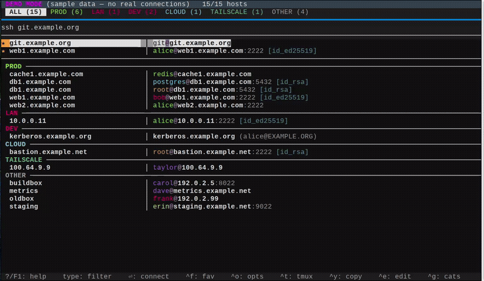

# ssh-wiz

Fast interactive SSH host picker — a console TUI (built on [Textual]) that
reads your `~/.ssh/config` and gets you connected.

- Fuzzy filter (`rzn9` → `ryzen9`), category tabs, per-user colors
- Ordering: favorites first, then A→Z by host within each category
  (the ALL view groups hosts by category)
- Per-host tmux sessions, ssh options panel (`^o`)
- Add-host wizard (`^a`): key generation, `ssh-copy-id`, key-auth check,
  backed-up `~/.ssh/config` append
- Live ssh command preview below the tabs (exactly what ⏎/^y will run)
- Host detail overlay (`^d`): the effective `ssh -G` config for a host
- `--json` host list and a `--check` config linter for scripting
- Fuzzy shell completion for bash, zsh and fish
- Single file, no build step

## Demo



## Install

Python 3.9+ with Textual and Rich. On SUSE/openSUSE the system package
pulls in both:

```sh
zypper in python3-textual python3-rich
```

Otherwise install from PyPI:

```sh
pip install "textual>=8.2.0" "rich>=13.0.0"
```

Put `ssh-wiz` on your `PATH` (it is a single executable script).

## Usage

```
ssh-wiz              launch the interactive picker
ssh-wiz -l           list hosts (favorites first, A→Z), no TUI
ssh-wiz --json       print the host list as JSON, no TUI
ssh-wiz --check      lint ~/.ssh/config (duplicates, shadows, dead keys)
ssh-wiz <host>       connect directly, no TUI
ssh-wiz <host> cmd   connect and run cmd (and args) on the host
ssh-wiz -p <host>    connect with -o PubkeyAuthentication=no
ssh-wiz -t <host>    connect inside a per-host tmux session (wiz-<host>)
ssh-wiz -f <host>    toggle favorite
ssh-wiz --complete <prefix>   print hosts/flags matching prefix (completion)
ssh-wiz --complete-hosts <prefix>  print user@host pairs matching prefix (completion)
ssh-wiz --completion <shell>  print completion script (bash, zsh or fish)
ssh-wiz --demo       launch the picker with built-in sample data
ssh-wiz --version    print the version
ssh-wiz -h           this help
```

### Demo mode

`ssh-wiz --demo` runs the picker with built-in sample data — fake hosts on
the RFC 2606 `example.*` domains, sample categories and favorites. Your
real `~/.ssh/config` and state are never read or written, and Enter only
shows the ssh command that would be run. Useful for demos and screenshots
without exposing real infrastructure.

### TUI keys

| key | action |
| --- | --- |
| type | fuzzy-filter hosts (letters in order, e.g. `rzn9` → `ryzen9`) |
| ←/→ (tab/shift-tab) | previous/next category |
| ↑/↓ · PgUp/PgDn · Home/End | move cursor |
| enter | connect to selected host |
| ^f | toggle favorite for selected host |
| ^o | toggle the ssh options panel (↑↓ select, ←→/⏎ cycle value, esc close) |
| ^t | toggle tmux mode (`tmux new -A -s wiz-<host>`; hint hidden when tmux is not installed) |
| ^y | copy the ssh command for the selected host |
| ^d | host detail overlay — the effective `ssh -G` config (esc/q/^d closes) |
| ^e | open `~/.ssh/config` at the selected host (`$EDITOR`) |
| ^g | open `~/.config/ssh-wiz/categories` (`$EDITOR`), then refresh |
| ^s | open the twin-panel file sync (local ↔ remote via rsync) |
| ^a | open the add-host wizard (key + `ssh-copy-id` + config append) |
| ? / F1 | show full key help (esc/?/F1/q closes) |
| ^r | refresh host list |
| esc | clear filter |
| ^q / ^c | quit |

### File sync (`^s`)

Press `^s` to open a Midnight-Commander-style twin-panel file picker. The left
panel shows your local filesystem; the right panel shows the filesystem of the
currently selected host (browsed with `rsync --list-only`).

- `Tab` switches between the local and remote panels; `↑/↓` moves the cursor.
- `enter`/`right` opens a directory, `left`/`backspace`/`up` goes up.
- `space` toggles a file, `*` selects all, `/` selects none in the current panel.
- `h` shows or hides hidden ('dot') files and directories in both panels at once
  (hidden files are hidden by default).
- `F5` (or `c`) pushes the chosen local files into the remote panel's current
  directory using `rsync -a --itemize-changes`, streaming a per-file result list
  and a progress line.
- `F6` (or `x`) pulls the chosen remote files into the local panel's current
  directory, same pipeline in the other direction.
- `F8` deletes the file/dir under the cursor in the active panel (locally, or via
  `ssh … rm -rf` on the remote panel).
- Selected files use a low-contrast indicator: a green check marks the selection
  while the name stays normally coloured. The cursor row gets a *subtle* blue
  background (not a harsh highlight bar) so you can always tell where you are,
  even after switching panels (`Tab` keeps the cursor on the last item you
  selected).
- Each row shows an ls-style date column next to the size: `MMM DD HH:MM` for a
  file touched in the last six months (or dated in the future), `MMM DD  YYYY`
  for an older one. Local dates come from `stat`, remote ones from the
  `rsync --list-only` listing (the remote host's clock). The ☐/name/date/size
  columns are fitted to the panel width so a row never wraps: a too-narrow panel
  drops the size column, then shortens the date to `MMM DD`, and only then clips
  the name with an ellipsis.
- `?`/`F1` shows sync help, `esc`/`q` closes.

The two panels are separated by a vertical line, the right-hand path bar shows the
remote host as `user@host`, and a shortcut legend runs along the bottom.

Transfers run in **both directions** (`F5` pushes, `F6` pulls), use the host's
key auth (no password prompt), and require `rsync` on the remote host — if it
is missing a clear message is shown instead of running the command. The
destination always gets a trailing slash, so a file drops into `dest/file` and
a directory into `dest/dir/`.

### Add host (`^a`)

`^a` opens a wizard that onboards a new host end to end. Fill in the form
(host, port, user, optional alias, key) — a live preview shows the exact
`~/.ssh/config` block that will be written and warns about earlier `Host`
patterns that would shadow it — then **Add host** runs the staged steps:

1. **Key** — pick an existing keypair or generate a per-host ed25519 key
   (`~/.ssh/id_ed25519_<host>`, empty passphrase). An existing generated key
   is only reused with your consent, never overwritten.
2. **Install** — `ssh-copy-id -o PubkeyAuthentication=no`; the password is
   entered on the handed-over terminal (skips publickey auth first, so a
   crowded ssh agent can't trip "Too many authentication failures").
3. **Verify** — a `BatchMode` ssh probe checks that key auth actually works.
   If the host refuses the key or is unreachable, the config is *not* written
   unless you confirm anyway.
4. **Write** — `~/.ssh/config` is backed up to `~/.ssh/config.bak` (refreshed
   on every write, mode 0600 — restore with `cp ~/.ssh/config.bak
   ~/.ssh/config`) and the new block is appended. The write is atomic, and a
   same-name `Host` block is refused up front.

Any failure keeps the form open so you can fix and retry in place;
`esc`/`q` cancels without touching anything. In `--demo` mode the config
write goes to the demo's temp file and keygen/copy-id/probe are shown, not
run.

### Shell completion

The host argument completes as a single connectable `user@host` token — and
only working `user@host` couples are offered (`rzn9` → `ryzen9`, like the TUI
fuzzy filter), so a completion is never split into a user and a host.
Flags complete by prefix.

```sh
# bash
eval "$(ssh-wiz --completion bash)"

# zsh
eval "$(ssh-wiz --completion zsh)"

# fish
ssh-wiz --completion fish | source
```

### Scripting and diagnostics

`ssh-wiz --json` prints the host list (favorites first, then A→Z — the same
order as `-l`) as a JSON array, one object per host with every field the
picker knows plus a `favorite` boolean. It never touches the network, so it
is a safe, structured view of `~/.ssh/config` for scripts:

```sh
ssh-wiz --json | jq -r '.[] | select(.category=="PROD") | .target'
```

Each object carries: `name`, `display`, `target`, `label`, `category`,
`user`, `host`, `port`, `cmd_port`, `principal`, `identityfile`, `extra`,
`favorite`.

`ssh-wiz --check` lints `~/.ssh/config` (read-only — it never rewrites or
connects) and prints one `file:line: severity: message` per finding:

- **warn** — a `Host` block whose keyword is silently overridden by an
  earlier wildcard block (ssh is first-match-wins), an `IdentityFile` that
  does not exist on disk, or a keyword/`Host` line with no value.
- **note** — informational, e.g. duplicate exact `Host` blocks that ssh
  merges on purpose (the documented multi-user pattern).

The exit status is `1` when any **warn** is found, `0` otherwise (notes
alone do not fail), so it drops straight into CI or a pre-commit hook:

```sh
ssh-wiz --check || echo "ssh config has warnings"
```

### Host detail (`^d`)

In the picker, `^d` opens a scrollable overlay with the **effective**
configuration for the selected host — the output of `ssh -G <target>`, which
is what `~/.ssh/config` resolves to after all `Host`/`Match` blocks (user,
hostname, port, identity files, proxies, …). The probe runs off the UI
thread and never connects (`ssh -G` only prints and exits), so it is instant
and side-effect free. `↑↓`/`PgUp`/`PgDn`/wheel scroll; `esc`/`q`/`^d` close.
In `--demo` mode the command is shown but not run.

> `^d` is safe as a binding: Textual puts the terminal in application (raw)
> mode, so Ctrl-D is delivered to the app as a key rather than acting as EOF.

## Configuration

Hosts are read from `~/.ssh/config` (or `$SSH_CONFIG` if set).
If the same host appears in several `Host` blocks with different `User`
values, each user gets its own entry: the first one (what plain `ssh <host>`
uses) keeps the host name, the others appear as `<host> (<user>)` and connect
as `user@host` — ssh still applies the config for the host (port,
identityfile, ...). The files below are optional; create them as needed.

### `~/.config/ssh-wiz/hosts` — extra hosts

Hosts that are not in `~/.ssh/config`. One per line:

```
name  user@host[:port]  [extra ssh args]
```

- `name` — the alias shown in the picker
- `user@host[:port]` — `user` may be omitted (your default user is used);
  the port is passed to ssh as `-p`
- `extra ssh args` — appended to the ssh command as-is

### `~/.config/ssh-wiz/categories` — categories

One rule per line: `<category>  <host pattern>  [color]`. The first matching
rule wins; patterns are shell globs matched case-sensitively against the host
name. Hosts matching no rule go to `OTHER`. Tab order follows first
appearance; without an explicit color, categories get a color from a fixed
palette.

Built-in IP ranges are auto-categorized when no user rule matches, so hosts
in the Tailscale CGNAT range `100.64.0.0/10` (100.64.0.0 – 100.127.255.255)
land in a `TAILSCALE` tab automatically — no rule needed. This covers both
`~/.ssh/config` names and extra hosts (via their target IP). A user rule
always wins over the built-in detection, so you can still pin a specific
Tailscale IP to another category.

### `~/.config/ssh-wiz/options` — ssh options for `^o`

One option per line: `<label>  <option=value1|value2|...>`. `^o` opens a
panel below the category tabs where each option cycles
`off → v1 → … → off`; enabled options are passed to ssh as `-o <value>`,
shown in the status bar, and remembered across runs
(`~/.local/state/ssh-wiz/options.json`). Without this file the built-in
defaults are offered:

```
no-pubkey  PubkeyAuthentication=no
x11        ForwardX11=yes
comp       Compression=yes|auto
```

`-p/--password` is shorthand for enabling `PubkeyAuthentication=no`.

### `~/.config/ssh-wiz/favorites` — favorites

One host name per line; `#` starts a comment.

## Tests

```sh
python3 test_ssh_wiz.py
```
